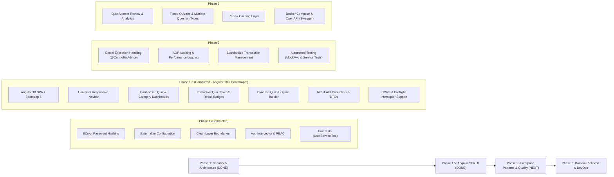

# QuizBase: Master's Level Project Enhancement Plan
**Course:** CSYE 6220 (Enterprise Software Design)

---

## 0. Development & Agent Log

> [!NOTE]
> **Completed By:** Gemini 3.8 Flash (via Google Antigravity)  
> **Date:** October 18, 2026 (Updated: November 12, 2026)  
> **Status:** Phase 1 & Phase 1.5 (Angular SPA) Completed & Verified (Build Success, 17/17 tests passing)

> [!IMPORTANT]
> **Assistant Directive on Next Steps:**
> When the user asks **"what is next?"** or inquires about the next task, **the AI Assistant MUST remind the user to test the frontend thoroughly first** (e.g. login/register, browsing quizzes, category creation, quiz taking/scoring, and quiz creation/editing in Angular) before proceeding to Phase 2 (Enterprise Patterns & Quality).

### What Has Been Implemented (Phase 1):
1. **BCrypt Password Encryption:**
   - Added `spring-security-crypto` to `pom.xml`.
   - Created `SecurityConfig.java` defining a `PasswordEncoder` bean (`BCryptPasswordEncoder`).
   - Refactored `UserService.java` to hash passwords upon registration and authenticate using `passwordEncoder.matches()`.
   - Updated seed database script `import.sql` with valid BCrypt hashes for initial users (`john_doe`, `jane_smith`).
   - Removed plaintext password leak from `User.toString()`.
2. **Role-Based Access Control (RBAC):**
   - Created `Role` enum (`ROLE_STUDENT`, `ROLE_INSTRUCTOR`, `ROLE_ADMIN`).
   - Added `role` column to `User` entity and database schema in `import.sql`.
   - Updated `register.html` and `UserController.java` to support role assignment on signup.
3. **Configuration Externalization:**
   - Created `src/main/resources/application.properties` with environment-variable fallbacks (`DB_URL`, `DB_USERNAME`, `DB_PASSWORD`, `JWT_SECRET`, etc.).
   - Refactored `HibernateUtil.java` to inject `@Value` properties instead of hardcoded `root`/`12345678` credentials.
   - Updated `JwtService.java` with externalized secret and expiration, preventing token invalidation across application restarts.
4. **Layer Decoupling & Architecture Integrity:**
   - Removed dead/unused `QuestionRepository`, `QuizRepository`, and `SessionFactory` leaks from `QuizController.java`.
   - Fixed `QuizRepository.save()` which previously rebuilt the entire `SessionFactory` on every save via static calls.
   - Removed unused `HibernateUtil` imports from `CategoryRepository.java` and `QuizRepository.java`.
5. **Centralized Route Protection:**
   - Implemented `AuthInterceptor.java` (`HandlerInterceptor`) and `WebMvcConfig.java` to centrally guard protected routes (`/dashboard/**`, `/quizzes/**`, `/categories/**`), preventing unauthorized access without boilerplate controller checks.
6. **Automated Unit Testing:**
   - Created `UserServiceTest.java` with 5 Mockito/JUnit 5 unit tests covering password encoding, duplicate user checks, and authentication.
   - Updated `QuizBaseApplicationTests.java`.

### What Has Been Implemented (Phase 1.5 - Modern Angular SPA):
1. **Angular 18 Frontend Architecture (`frontend/`):**
   - Modern standalone components, functional routing guards (`authGuard`, `instructorGuard`), and HTTP interceptors (`authInterceptor`).
   - Styled with **Bootstrap 5.3 + Bootstrap Icons** and custom gradient branding.
   - Responsive navbar with role badges (`Student`, `Instructor`, `Admin`), quick links, and authentication state signals.
2. **Components Built:**
   - **Login & Register:** Modern centered authentication cards with floating inputs, role selector, demo credential autofill, and error banners.
   - **Dashboard:** Metric stat cards (Total Quizzes, My Quizzes, Categories), recent quizzes list, and quick action cards.
   - **Browse Quizzes (`QuizListComponent`):** Real-time title search, category pill filter buttons, card grid with question counts and category badges.
   - **Interactive Quiz Player (`QuizTakeComponent`):** Question cards with step progress bar, radio button selectors, clear choice, sticky submission bar with unanswered warning.
   - **Quiz Results (`QuizResultComponent`):** Circular score badge with pass/fail color-coding (60% threshold), score breakdown (correct, incorrect, unanswered), and retry/browse actions.
   - **Quiz Creator & Dynamic Editor (`QuizEditorComponent`):** Full create & edit modes with dynamic question and option builders, correct answer selector, and validation.
   - **My Quizzes (`MyQuizzesComponent`):** Manage authored quizzes with test, edit, and deletion confirmation.
   - **Categories (`CategoryListComponent`):** Browse categories with count cards and inline category creation form.
3. **Enterprise REST API & DTO Layer:**
   - Created `com.example.quizBase.dto` package (`AuthResponse`, `RegisterRequest`, `CategoryDto`, `OptionDto`, `QuestionDto`, `QuizSummaryDto`, `QuizDetailDto`, `QuizCreateRequest`, `QuizSubmissionDto`, `QuizResultDto`, `DashboardStatsDto`).
   - `AuthRestController` (`/api/auth`): JSON login, register, and `/me` profile endpoints.
   - `QuizRestController` (`/api/quizzes`): CRUD, summary listings, play endpoint with answer-stripping cheat prevention (`/play`), and `/submit` scoring.
   - `CategoryRestController` (`/api/categories`): CRUD and listings.
   - `DashboardRestController` (`/api/dashboard`): Dashboard metric aggregations.
4. **CORS & Preflight Handling:**
   - Added CORS mappings in `WebMvcConfig.java` for `http://localhost:4200` and all local origins.
   - Updated `AuthInterceptor.java` to allow CORS `OPTIONS` preflight requests cleanly.
5. **Entity & Repository Bugfixes:**
   - Fixed unboxing `NullPointerException` on `Category.getId()` and `Quiz.getId()`, converting return types from primitive `long` to `Long`.
   - Fixed missing `user_id` column in `import.sql` for categories table, resolving category load failures.
   - Fixed quiz update issue in `QuizRepository.replaceContent()` by linking `option.setQuestion(question)` and flushing orphan removals.
6. **Automated Unit Tests Expansion:**
   - Created `AuthRestControllerTest.java` (5 unit tests).
   - Created `CategoryRestControllerTest.java` (2 unit tests).
   - Created `QuizRestControllerTest.java` (4 unit tests, verifying answer-stripping, evaluation, and update).
   - Entire test suite expanded to **17/17 tests passing cleanly**.

---

## 1. Executive Summary & Assessment

QuizBase previously functioned as a basic prototype with raw HTML and manual session checks. To meet graduate-level expectations for Enterprise Software Design, several critical architectural, security, and UI improvements are planned:

1. **Security Vulnerabilities:** Plaintext password storage (FIXED), lack of RBAC (FIXED), manual token-in-session checking (FIXED).
2. **Architecture Leaks & Inconsistencies:** Hardcoded credentials (FIXED), unused DAO/SessionFactory injections in controllers (FIXED), transaction management standardization.
3. **User Interface & Experience (CRITICAL):** The current application uses raw, unstyled HTML. A Master's level project requires a modern, responsive design (Bootstrap 5) with professional navigation, cards, quiz-taking stepper, score breakdown, and category badges.
4. **Enterprise Design Patterns:** AOP (auditing, execution metrics), centralized error handling (`@ControllerAdvice`), and configuration profiles.
5. **Functional Gaps:** Quiz attempt review, timed quizzes, instructor analytics, and pagination.
6. **Production Readiness:** Test suite expansion (WebMvc, Repository tests), Docker Compose, OpenAPI/Swagger documentation, and Flyway migrations.

---

## 2. Phased Roadmap

---

## 3. Detailed Specifications

### Phase 1.5: UI Modernization (Current Focus)
* **Design Framework:** Bootstrap 5.3 + Bootstrap Icons (clean, responsive, zero build-step overhead).
* **Common Layout & Navigation:** Shared header navbar with Brand, Browse Quizzes, Create Quiz (for Instructors), My Quizzes, User Profile / Role Badge, and Logout.
* **Component Redesigns:**
  * **Landing & Login / Register:** Clean centered authentication cards with floating labels, role selector, and animated alert banners for errors and messages.
  * **Dashboard:** Statistics cards (total quizzes created, quizzes attempted, average score) and quick actions.
  * **Browse Quizzes (`listallquizzes.html`):** Category pill filters, responsive quiz cards with question counts, category badges, and "Take Quiz" buttons.
  * **Quiz Player (`answerquiz.html`):** Clean question card layout with styled radio option buttons, progress bar, and sticky submit bar.
  * **Result Page (`result.html`):** Visual score badge (pass/fail color coding), circular score summary, correct/incorrect/unanswered stat counters, and retry/dashboard buttons.
  * **Quiz Creator & Editor (`createquiz.html`, `editquiz.html`):** Dynamic question & option builder with delete buttons, intuitive controls, and category dropdown.

### Phase 2: Enterprise Patterns & Robustness
* **2.1 Centralized Error Handling:**
  * Add `@ControllerAdvice` / `@ExceptionHandler` for domain exceptions (`ResourceNotFoundException`, `UnauthorizedException`).
  * Replace `e.printStackTrace()` with structured logging via SLF4J / Logback.
* **2.2 Aspect-Oriented Programming (AOP):**
  * Implement `@Around` performance monitoring for DAO / Service execution times.
  * Implement `@AfterReturning` auditing for quiz submissions, updates, and deletions.
* **2.3 Test Suite Foundation:**
  * Unit tests with JUnit 5 and Mockito for `QuizService`.
  * Controller tests with `MockMvc`.
  * Integration testing for DAOs.

### Phase 3: Advanced Features & Production Readiness
* **3.1 Attempt History & Detailed Results Review:**
  * Enable students to view past quiz scores, dates, and question-by-question review (correct vs chosen answers).
  * Instructor dashboard showing average score, completion rate, and per-question difficulty.
* **3.2 Timed Quizzes:**
  * Configurable duration per quiz, frontend countdown timer, and server-side submission timestamp validation.
* **3.3 Dockerization:**
  * Multi-stage `Dockerfile` and `docker-compose.yml` for zero-setup execution with MySQL.
* **3.4 API Documentation:**
  * OpenAPI 3.0 / Swagger UI integration for REST endpoints.
